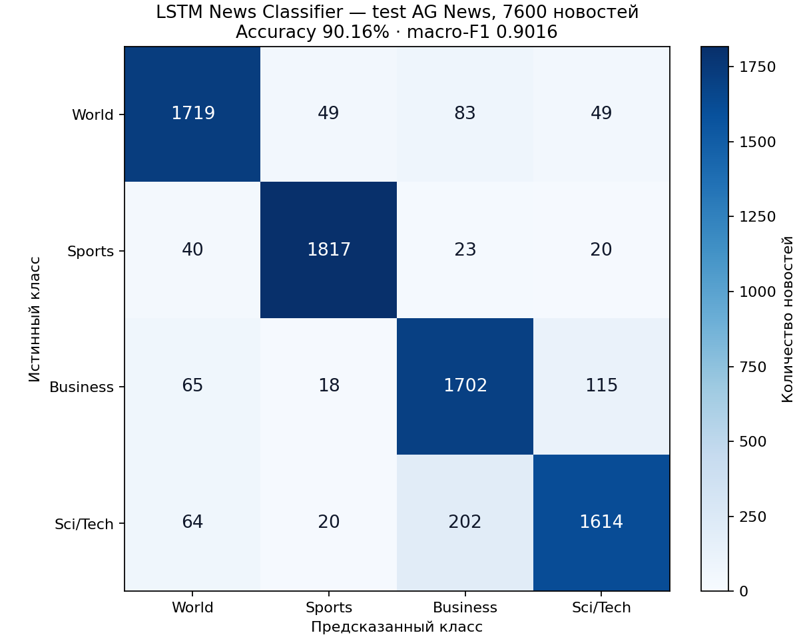

# LSTM News Classifier

[Русский](README.md) · **English**

An English news classifier built in PyTorch. It takes a headline and description and predicts one of four topics: **World, Sports, Business, or Sci/Tech**.

## Data and preprocessing

AG News CSV files have three columns and no header: label, title, and description. The script concatenates the headline and description, maps labels 1–4 to 0–3, and stratifies the original training set with seed 42. The official test set is evaluated separately. [Source, checksums, and noncommercial data terms](data/README.md)

| Split | Articles |
|---|---:|
| Train | 96,000 |
| Validation | 24,000 |
| Official test | 7,600 |

The train-only vocabulary holds up to 30,000 tokens. `<PAD>` is ID 0, and `<UNK>` is ID 1. Tokenization uses `lower().split()` and keeps punctuation attached. Sequences are truncated to 64 tokens or padded on the right.

## Architecture and training

```text
Word IDs [batch, 64] → Embedding(30000, 128, padding_idx=0)
→ single-layer LSTM(128, 256) → output at last non-padding position
→ Linear(256, 4) → class logits
```

The network has **4,236,292 trainable parameters**, mostly in the embedding table. Embeddings are trained from scratch. Training uses batch size 64, cross-entropy, and AdamW at 0.001. The lowest validation loss selects the checkpoint. `--epochs` defaults to 1. CUDA is used when available.

## Saved checkpoint results

On 18 November 2026 the saved weights were evaluated on the reconstructed validation split and official test set.

| Split | Accuracy | Macro-F1 | Cross-entropy per article |
|---|---:|---:|---:|
| Validation | **90.50%** | 0.9051 | 0.2831 |
| Test | **90.16%** | 0.9016 | 0.3039 |



The complete reconstructed training vocabulary matched the saved `stoi`. The checkpoint lacks epoch, dataset hash, and split indices. Prior use of the test set during development is unknown. [Raw metrics and per-class scores](reports/metrics.json)

## Run on Windows

Verified with Python 3.13.2, PyTorch 2.10.0+cu126, pandas 3.1.1, and scikit-learn 1.9.1. [PyTorch installation guide](https://pytorch.org/get-started/locally/)

```powershell
git clone https://github.com/Awuiga/lstm-news-classifier.git
cd lstm-news-classifier
py -3.13 -m venv .venv
.\.venv\Scripts\Activate.ps1
python -m pip install -r requirements.txt

New-Item -ItemType Directory -Force data | Out-Null
Invoke-WebRequest -Uri 'https://raw.githubusercontent.com/mhjabreel/CharCnn_Keras/555590db4219b1243abb1918effd6a7425a2d75f/data/ag_news_csv/train.csv' -OutFile 'data/train.csv'
Invoke-WebRequest -Uri 'https://raw.githubusercontent.com/mhjabreel/CharCnn_Keras/555590db4219b1243abb1918effd6a7425a2d75f/data/ag_news_csv/test.csv' -OutFile 'data/test.csv'

python train.py --epochs 1
python predict.py
python evaluate.py
```

- `train.py` starts from scratch. It saves the best weights to `lstm_model.pt`, evaluates them on test, and saves the full `lstm_checkpoint.pt` with the vocabulary and model settings.
- `predict.py` labels the sample sentence about Manchester United and Chelsea. Replace `text` with a nonempty article to try another input. Its confidence is the maximum softmax score. Calibration has not been measured.
- `evaluate.py` checks the vocabulary, scores validation and test, and writes `reports/metrics.json`. See `--help` for alternate paths.
- `python train.py --epochs 0` evaluates an existing `lstm_model.pt`. The published default is one epoch so a fresh clone can create weights. Checkpoints do not contain optimizer state.

## Limitations

Seed 42 fixes the split. Initialization and batch ordering remain random. Training averages validation batch means, while test and standalone evaluation weight every example equally. Truncation loses the end of longer articles, punctuation stays attached, and empty inputs are unsupported. Duplication across splits, performance on other domains, and Russian-language news have not been evaluated. The training history for the saved weights is unavailable. [Verification](VERIFICATION.md)
