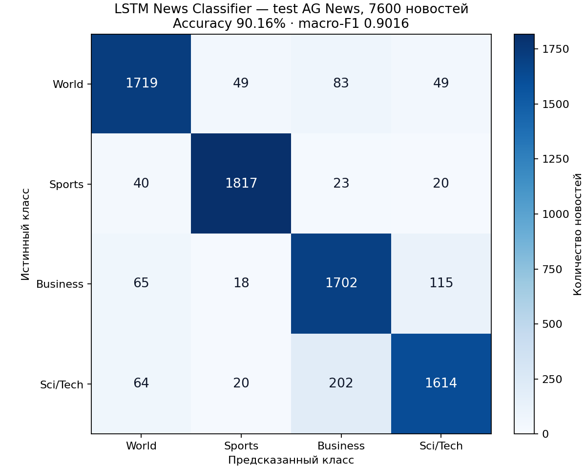

# LSTM News Classifier

Учебный классификатор англоязычных новостей на PyTorch. Модель читает заголовок и описание новости и выбирает тему: **World, Sports, Business или Sci/Tech**.

Проект включает подготовку словаря, Dataset и DataLoader, обучение LSTM, сохранение лучших весов по validation loss и оценку на официальном test AG News. Это отдельный проект, не часть Fashion CNN или GRU Text Generator.

## Данные и подготовка текста

Используется [AG News](data/README.md). В CSV без заголовка находятся три поля: номер класса, заголовок и описание. Заголовок и описание объединяются через пробел; метки 1–4 переводятся в 0–3.

| Выборка | Новостей | Как получена |
| --- | ---: | --- |
| Train | 96 000 | 80% исходного train |
| Validation | 24 000 | 20% исходного train, стратификация и `random_state=42` |
| Test | 7600 | Отдельный официальный test |

Словарь строится **только по train**: максимум 30 000 токенов, из них `<PAD>` имеет ID 0, `<UNK>` — ID 1. Токенизация простая: `lower().split()`. Пунктуация остаётся частью слов. Каждая новость обрезается до первых **64 токенов** или дополняется PAD справа.

Исходные новости не включены в Git. Происхождение, хеши и условия некоммерческого использования описаны в [data/README.md](data/README.md).

## Архитектура

```text
ID слов [batch, 64]
       ↓
Embedding(30 000, 128, padding_idx=0)
       ↓
Однослойная LSTM(input_size=128, hidden_size=256)
       ↓
Выход на последнем непустом токене каждой новости
       ↓
Linear(256, 4)
       ↓
Logits четырёх тем
```

Всего **4 236 292 обучаемых параметра**, большая часть — в Embedding. Предобученные векторы слов не используются. Выбор последней непустой позиции позволяет брать представление новости до добавленного справа padding.

| Параметр | Значение |
| --- | --- |
| Batch size | 64 |
| Оптимизатор | AdamW |
| Learning rate | 0.001 |
| Функция ошибки | CrossEntropyLoss |
| Устройство | CUDA, если доступна, иначе CPU |
| Выбор весов | Минимальный validation loss среди эпох текущего запуска |
| Число эпох | Параметр `--epochs`, по умолчанию 1 |

## Результаты сохранённой модели

18 ноября 2026 года локальный `lstm_checkpoint.pt` оценён без переобучения и подбора настроек:

| Выборка | Accuracy | Macro-F1 | Cross-entropy на новость |
| --- | ---: | ---: | ---: |
| Validation, 24 000 новостей | **90,50%** | 0,9051 | 0,2831 |
| Test, 7600 новостей | **90,16%** | 0,9016 | 0,3039 |



Точные метрики и результаты по классам находятся в [reports/metrics.json](reports/metrics.json). Это оценка уже сохранённых весов: checkpoint не хранит число пройденных эпох, хеш корпуса и индексы train/validation. При проверке разбиение восстановлено по исходному коду, весь построенный словарь совпал с сохранённым `stoi`.

История использования test при разработке неизвестна, поэтому эти числа не объявляются результатом гарантированно нетронутого финального benchmark. После нового обучения результат может измениться.

## Запуск на Windows

Проверенное окружение: Python 3.13.2, PyTorch 2.10.0+cu126, pandas 3.1.1, scikit-learn 1.9.1.

```powershell
git clone https://github.com/Awuiga/lstm-news-classifier.git
cd lstm-news-classifier
py -3.13 -m venv .venv
.\.venv\Scripts\Activate.ps1
python -m pip install -r requirements.txt
```

Скачайте CSV из зафиксированной ревизии источника:

```powershell
New-Item -ItemType Directory -Force data | Out-Null
Invoke-WebRequest -Uri 'https://raw.githubusercontent.com/mhjabreel/CharCnn_Keras/555590db4219b1243abb1918effd6a7425a2d75f/data/ag_news_csv/train.csv' -OutFile 'data/train.csv'
Invoke-WebRequest -Uri 'https://raw.githubusercontent.com/mhjabreel/CharCnn_Keras/555590db4219b1243abb1918effd6a7425a2d75f/data/ag_news_csv/test.csv' -OutFile 'data/test.csv'
```

Далее все команды выполняются из корня проекта:

```powershell
python train.py --epochs 1
python predict.py
python evaluate.py
```

Число эпох можно задать, например, `python train.py --epochs 3`. Это выбор длительности нового запуска, а не утверждение о том, сколько эпох проходили опубликованные в отчёте веса.

### Скрипты и файлы весов

- **`train.py`** обучает модель с нуля, оценивает validation после каждой эпохи, сохраняет лучшие веса в `lstm_model.pt`. Затем загружает их, считает test loss, accuracy и macro-F1 и записывает полный `lstm_checkpoint.pt` со словарём и настройками.
- **`predict.py`** загружает `lstm_checkpoint.pt` и классифицирует заданную в коде строку `Manchester United won the football match against Chelsea`. Чтобы проверить свою непустую новость, измените переменную `text`. Интерактивного ввода пока нет.
- **`evaluate.py`** отдельно оценивает полный checkpoint на validation и test, проверяет совпадение словаря с восстановленным train и обновляет `reports/metrics.json`. Ничего не обучает и не изменяет веса; пути доступны через `python evaluate.py --help`.

`Confidence` в `predict.py` — значение максимального softmax в процентах, а не проверенная вероятность правильного ответа. Калибровка уверенности не выполнялась.

В исходном рабочем файле стояло `epochs = 0`: он только оценивал уже имеющиеся веса. В опубликованной копии это заменено параметром `--epochs`, по умолчанию **1**, чтобы проект запускался с нуля. Режим `python train.py --epochs 0` сохранён для оценки существующего `lstm_model.pt`; без него команда выдаст понятное сообщение. Это не продолжение обучения, состояние AdamW не сохраняется.

Готовые веса в Git не включены. После клонирования сначала обучите модель. Новый запуск перезаписывает локальные файлы весов; исходная рабочая папка пользователя при подготовке публикации не изменялась. Загружайте только доверенные checkpoints. Для отдельной CUDA-сборки используйте [официальную страницу PyTorch](https://pytorch.org/get-started/locally/).

## Ограничения и воспроизводимость

- Seed 42 фиксирует только разбиение train/validation. Инициализация LSTM и перемешивание батчей отдельно не фиксированы, поэтому повторное обучение не обязано воспроизвести опубликованные числа.
- Сохраняется лучшая модель по validation loss, однако validation loss в `train.py` усредняется по батчам без поправки на размер последнего. Test loss и loss отдельного `evaluate.py` усредняются по всем объектам.
- Обрезка до 64 токенов теряет конец длинной новости. Простая токенизация не разделяет пунктуацию. Пустые строки не поддерживаются исходной логикой выбора последнего токена.
- Отдельной очистки дубликатов и проверки пересечений текстов между выборками нет. Качество на русскоязычных новостях и других доменах не проверено.
- Логи исходного обучения не сохранены; история loss и количество его эпох не восстанавливались по предположениям.

Архитектура, токенизация и основная учебная логика сохранены. Изменён только способ задания эпох и добавлена отдельная оценка. Проверки описаны в [VERIFICATION.md](VERIFICATION.md). Данные, веса, окружения и рабочие логи исключены из Git. Отдельная открытая лицензия на код пока не выбрана автором.
